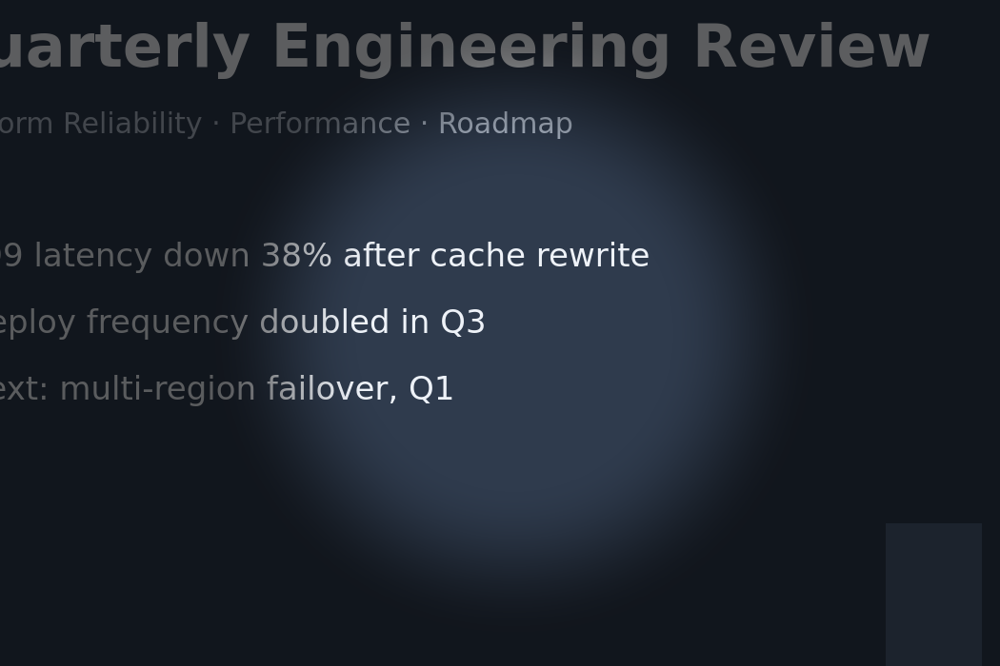

# spotlight

Real-time spotlight overlay for X11 — the whole screen is dimmed except a soft circle around the cursor.
Click-through, grabs no keys, ~3 MB RAM.

实时聚光灯（X11 原生）：整屏压暗，鼠标周围保留一个边缘柔和的圆形亮区，实时跟随。
窗口点击穿透、不抓任何键盘按键，屏幕共享时观众也能看到。



## 用法

    spotlight [--dim 0.55] [--radius 160] [--soft 0.5] [--debug]

| 参数 | 默认 | 说明 |
|---|---|---|
| `--dim` | 0.55 | 压暗程度 0~1 |
| `--radius` | 160 | 亮区半径（像素） |
| `--soft` | 0.5 | 边缘柔和度 0~1（0 = 硬边） |
| `--debug` | - | 打印光圈图 alpha 自检 |

退出：`Ctrl+C` 或 `pkill -x spotlight`。

## 编译与安装

```sh
make            # 生成 ./spotlight
make install    # 安装到 ~/.local/bin
```

依赖：`libX11-devel libXrender-devel libXext-devel`。

## 实现说明

- 光圈不是用 `XRenderCreateRadialGradient` 画的：该 API 在部分 X server
  上烘焙结果是实心方块。这里改为**手工生成 32 位 ARGB 的 alpha 渐变图**，
  用 `XPutImage` 上传，再以 `PictOpSrc` 贴到暗层上，四角 alpha 与暗层一致，无缝。
- 可用 `--debug` 验证：中心 alpha=0、边缘/角落 alpha=`dim*255`。

## 说明

- 仅支持 X11（32 位 ARGB visual + XRender）。
- 输入区域为空（XShape），不拦截任何点击，可与其它覆盖层工具共存。

## License

未指定（All rights reserved）。如需开源授权请自行添加 LICENSE。
